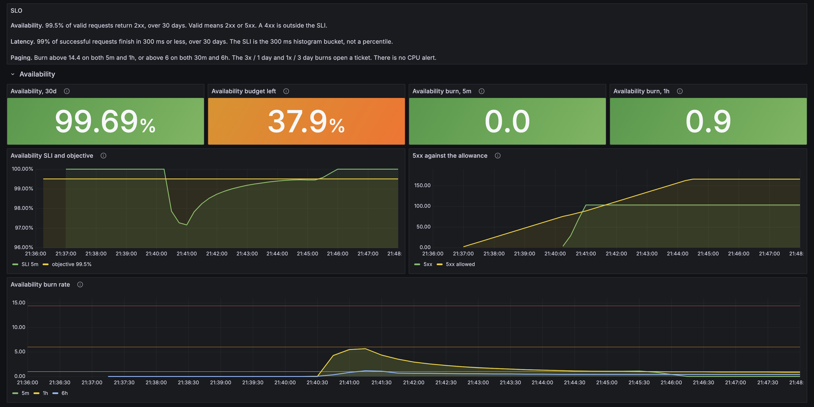
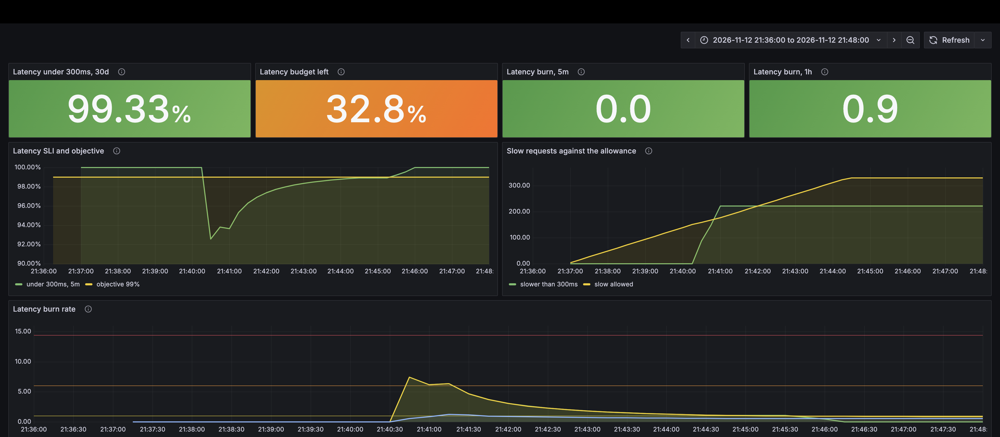
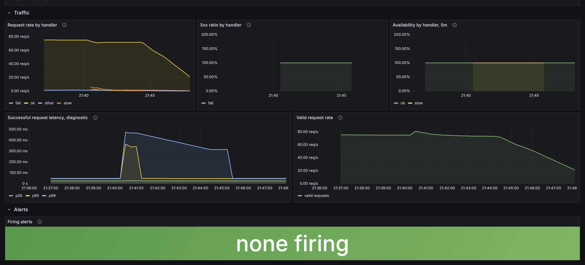

# sli-slo-baseline

A local stand for one idea: page on the error budget, not on CPU.

A small HTTP service exposes a request counter and a latency histogram. VictoriaMetrics stores the scrapes. vmalert computes two SLIs, two 30-day error budgets, and the multi-window burn alerts from the SRE workbook. Grafana reads VictoriaMetrics with PromQL.

This is a portfolio example. The thresholds are the workbook's starting point for a 30-day window. They are not a production promise, and they are not a record of any employer's alert thresholds.

## SLIs

Both SLIs are ratios of good events to valid events.

| | Good event | Valid event | Outside the SLI |
|---|---|---|---|
| Availability | HTTP 2xx | 2xx or 5xx | 4xx |
| Latency | a 2xx at or under 300 ms | a 2xx | 4xx and 5xx |

A 404 is a client miss. Counting it as a success makes a broken link look like a healthy service. Counting it as a failure spends the budget on the caller. It is in neither side of the ratio. If the service receives only 404s, the SLI is empty. It is not 100%.

A 500 spends the availability budget. It is not a latency sample. A fast failure must not improve the latency SLI.

The latency SLI is the share of successful observations in the `le="0.3"` bucket. `histogram_quantile` interpolates between buckets and does not aggregate cleanly, so it is a diagnostic chart, not the SLI.

`handler` is a closed set: `ok`, `fail`, `slow`, `other`. The SLO is the total. The dashboard splits that total by handler so one path is visible. There is no per-handler alert. A label per user or per raw URL would make the ratio noise.

## Objectives

Both windows are 30 days.

| SLO | Objective | Error budget |
|---|---|---|
| Availability | 99.5% of valid requests are 2xx | 0.5%, about 3.6 hours |
| Latency | 99% of successful requests finish in 300 ms | 1% |

Burn rate is `(1 - SLI) / (1 - objective)`. A burn rate of 1 spends that budget exactly on schedule.

The multipliers below come from the 30-day length. They stay put if the objective changes. They change if the window stops being 30 days. At 99.5% availability, burn 14.4 is a 7.2% error ratio. At the 99% latency objective, the same burn is a 14.4% slow ratio. A 90% objective would be too loose for the fast page: a total outage for one hour would still sit under 14.4. 99.5% does not have that problem.

## Alerts

The pairs are the worked example in the SRE workbook, section 6. Both windows have to be over the same burn rate. The short window is one twelfth of the long one, so the alert resets a few minutes after the burn stops instead of waiting out the long window.

| Severity | Long window | Short window | Burn rate | Budget consumed |
|---|---|---|---|---|
| Page | 1 hour | 5 minutes | 14.4 | about 2% |
| Page | 6 hours | 30 minutes | 6 | about 5% |
| Ticket | 1 day | 2 hours | 3 | about 10% |
| Ticket | 3 days | 6 hours | 1 | about 10% |

The 6x window is a page. A ticket there would wait out a burn that spends 5% of the month in six hours.

A full outage trips every pair. This stand has no Alertmanager, so nothing inhibits the slower alerts, and vmalert drops the notification after it evaluates it (`-notifier.blackhole`). The firing series is what the dashboard shows.

Each alert also requires 0.1 valid requests per second on its short window. Below that, one failure dominates the ratio. That floor is for this stand. A busier service raises it. The short window is the one that still shows the burn in progress. `rate()` on a window longer than the series undercounts, so the floor does not sit there.

There is no CPU alert. CPU does not say whether users are failing.

## Dashboard

http://127.0.0.1:3000/d/sli-slo

The pictures are one local run, frozen to the twelve minutes around a short notch. For about a minute the service mixed in failures and slow successes, then went back to healthy traffic. The 30-day budgets moved. The burn stayed under the page line. Nothing fired.

The top of the board states the two SLOs. Under that, for each SLO: the 30-day SLI, the budget left, the 5m and 1h burn, the SLI against its objective, the bad requests against the allowance, and the burn rates with lines at 1, 6 and 14.4.



Slow successes spend the latency allowance. They are not availability samples, so that budget does not move with them.



The traffic row is RED, which is the part a person needs once the burn is already moving:

- request rate by handler, 4xx included, so the excluded traffic is still visible
- 5xx ratio by handler, which is the availability input
- availability by handler
- p50, p95 and p99 of successful requests, marked as a diagnostic because they are not the SLI
- valid request rate, because a busy minute spends the budget faster than a quiet one at the same error ratio



The budget stat is the share of the allowance still unused, not a percent of the requests and not a slice of the month. 100% means the allowance is untouched. 0% means it is spent. Below 0%, each extra -100% is one more budget the requests so far have used. It uses the 30-day recording rule, not the dashboard time picker. On a stand younger than 30 days that rule only covers the samples kept so far, so a short run of 500s spends many budgets: almost every request failed, and 99.5% allows only 0.5% of them to fail. The chart next to the stat shows those two counts. The 3.6 hours in the table above is what 0.5% of a month is when every minute carries the same traffic. Retention here is 15 days.

Grafana opens without a login. Do not expose it past the laptop.

## Run

Docker Desktop has to be running.

```sh
docker compose up --build
```

- App: http://127.0.0.1:8080/ok
- Fail on purpose: http://127.0.0.1:8080/fail
- Slow on purpose (400 ms, then 200): http://127.0.0.1:8080/slow
- Not a route (404, outside both SLIs): http://127.0.0.1:8080/missing
- Metrics: http://127.0.0.1:8080/metrics
- VictoriaMetrics: http://127.0.0.1:8428

```sh
./scripts/quiet.sh
./scripts/burst.sh
./scripts/slow.sh
./scripts/miss.sh
```

`quiet.sh` holds both SLIs up. `burst.sh` sends 500s for 30 seconds and should move only the availability burn. `slow.sh` sends slow 200s for 30 seconds and should move only the latency burn. `miss.sh` sends 404s. Next to `quiet.sh` the availability line stays put. Alone, the SLI goes blank rather than showing 100%.

Thirty seconds is not a page. The fast page also needs the 1-hour burn above 14.4, which on a quiet hour is several minutes of failures, not a short burst.

`promtool test rules` on `victoria/tests/sli.test.yml` is the check that the ratios and the four severities do what the table says. The same files are loaded with `vmalert -dryRun`. Both run in CI.

## Requests and limits

An autoscaler percentage is calculated from requests, not from limits. Requests are the capacity the scheduler reserved. Limits are the cgroup ceiling. A pod at 50% of its limit can still be far above the capacity promised to the scaler. The SLI above is a percentage of requests the user made, which is a different percentage again.
